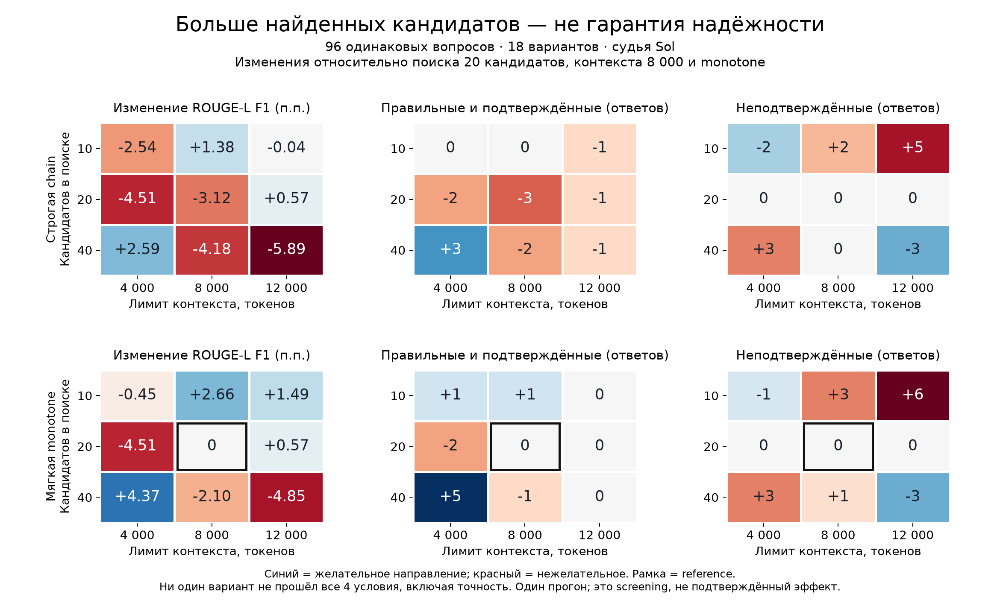

# Joint retrieval and context tuning: negative screening result

None of the 18 evaluated configurations passed the predeclared selection criteria. The RAGU method and recommended configuration remain unchanged. The 300-question expansion was not run; the separate 152 fresh questions remain untouched.

## Experiment

On 96 questions from the previously studied MuSiQue development cohort, we compared three initial direct paragraph retrieval depths (`dense_top_k=10/20/40`), three context budgets (`4000/8000/12000` tokens), and two recovery guards (`chain`, `monotone`). The cohort was frozen before execution, stratified by question hop count with seed 20261013. The reference was `20/8000/monotone`, regenerated under the same harness.

Each of the nine retrieval/context pairs ran the entire production path: retrieval, planning, initial answer, UNKNOWN review, and recovery retrieval. Both guards received identical generated candidates through exact replay of preceding messages, schemas, and responses. The recovery guard does not inspect initial substantive answers. Graph retrieval depth, subsequent search depths, and other parameters remained fixed.

Luna through the subscription backend handled generation and RAGU verification; Sol was the independent LLM judge. The existing BGE-small-en-v1.5 graph and 384-dimensional index were retained. This is not a reproduction of the authors' GTE experiment. We adopted joint parameter exploration from *Machine Learning-Driven RAG System Design*; no surrogate model of configuration quality was trained.

A candidate had to preserve precision among substantive answers, avoid increasing the **absolute count** of unsupported answers, increase the correct-and-supported count, and preserve unstemmed ROUGE-L F1. The reference is not eligible as a new candidate. Every one of the 17 alternatives failed at least one condition.

## All results

Each row contains 96 questions. “Correct and supported” requires positive separate Sol judgments for correctness and support from the exact visible context. An unsupported answer can still match the reference. Calls are logical counts, including shared replayed stages; adding them across guards would overstate executed requests.

| k | Budget | Guard | ROUGE-L | Correct / answered | Correct and supported | Unsupported | Calls |
|---:|---:|---|---:|---:|---:|---:|---:|
| 10 | 4000 | chain | 0.414372 | 43/56 | 37 | 16 | 347 |
| 10 | 4000 | monotone | 0.435205 | 45/58 | 38 | 17 | 377 |
| 10 | 8000 | chain | 0.453580 | 46/64 | 37 | 20 | 316 |
| 10 | 8000 | monotone | 0.466312 | 48/66 | 38 | 21 | 340 |
| 10 | 12000 | chain | 0.439293 | 49/65 | 36 | 23 | 308 |
| 10 | 12000 | monotone | 0.454612 | 51/67 | 37 | 24 | 334 |
| 20 | 4000 | chain | 0.394655 | 44/58 | 35 | 18 | 335 |
| 20 | 4000 | monotone | 0.394655 | 44/58 | 35 | 18 | 361 |
| 20 | 8000 | chain | 0.408483 | 43/58 | 34 | 18 | 330 |
| 20 | 8000 | monotone **reference** | 0.439733 | 46/62 | 37 | 18 | 362 |
| 20 | 12000 | chain | 0.445474 | 45/64 | 36 | 18 | 318 |
| 20 | 12000 | monotone | 0.445474 | 46/65 | 37 | 18 | 341 |
| 40 | 4000 | chain | 0.465609 | 52/68 | 40 | 21 | 314 |
| 40 | 4000 | monotone | 0.483412 | 54/70 | 42 | 21 | 334 |
| 40 | 8000 | chain | 0.397939 | 44/58 | 35 | 18 | 335 |
| 40 | 8000 | monotone | 0.418772 | 46/60 | 36 | 19 | 366 |
| 40 | 12000 | chain | 0.380796 | 43/57 | 36 | 15 | 324 |
| 40 | 12000 | monotone | 0.391212 | 44/58 | 37 | 15 | 360 |

## Why no configuration was selected

`40/4000/monotone` produced the highest ROUGE-L and correct-and-supported count: **0.483412 and 42**, versus the reference's **0.439733 and 37**. Precision was 54/70 (77.14%), versus 46/62 (74.19%). However, unsupported answers increased to **21 from 18**, so the candidate was rejected. The wrong-answer count remained 16; these categories are distinct.

The more conservative `10/4000/monotone` produced 38 correct-and-supported answers and 17 unsupported answers, with precision 45/58 (77.59%). Its ROUGE-L fell to **0.435205**, so it also failed selection. Close results do not justify relaxing a threshold after observing outcomes.

Paired bootstrap used 10,000 replicates and seed 42. For `40/4000/monotone`, the ROUGE-L difference was +0.043679, with a 95% interval [−0.031146, +0.120254]; the correct-and-supported count difference was +5, interval [−1, +11]; the unsupported count difference was +3, interval [−6, +12]. For `10/4000/monotone`, the ROUGE-L difference interval was [−0.074435, +0.064687]. The intervals for key changes in these two candidates include zero. They do not establish improvement or noninferiority.

Not every interval across the table includes zero: `20/8000/chain` has a higher unsupported fraction among answers than the reference, difference interval [+0.003672, +0.043462], despite the same absolute count of 18. This further illustrates why both counts and rates must be reported.

## What the unsupported answers reveal

Trace inspection found `answer_guard.applied=false` for all **18** unsupported reference answers and all **21** unsupported answers from `40/4000/monotone`. They came from initial substantive generation, which the current recovery guard does not inspect. All three accepted recoveries for `40/4000/monotone` were judged correct and supported. Tightening only the recovery guard therefore does not address the observed source of these errors.

A next research hypothesis is to retrieve a missing evidence link and repair the main answer before returning it: assess its contextual support, retrieve specifically for an identified gap, then regenerate and check the answer. This needs a separate protocol; it is not an implemented or validated improvement, and cannot yet be promised to reduce errors without sacrificing coverage.

## Limitations and reproducibility

An independent recomputation checked all 1,728 final results against source answers, actual Sol requests, and verdicts; no inconsistencies were found. The support judge received only the question, answer, and retrieved context. A separate rejected-candidate audit found:

| Monotone recipe | Rejected | Correct among rejected | Correct and supported among rejected |
|---|---:|---:|---:|
| 20 / 8000, reference | 22 | 13 | 5 |
| 10 / 4000 | 23 | 11 | 5 |
| 40 / 4000 | 14 | 6 | 1 |

False rejections remain, but not every rejected candidate is a false rejection. For example, 13 rejected reference candidates were correct, but only 5 were judged supported by their context.

Execution used 3,175 unique Luna calls and 983 Sol calls. Local logs record 82,126,165 and 25,019,719 input tokens respectively, including 53,089,536 and 17,080,192 cached tokens; output tokens were 434,382 and 112,353. Cached tokens are already included in input tokens. These are execution-log observations, not monetary costs. UNKNOWN answers received mechanical verdicts; identical complete judge requests reused their verdicts.

This was a small screening study on previously studied questions, with one generation run per configuration. Differences across retrieval/context pairs include generation variability; exact paired replay applies to the two guards within a pair. Sol is fallible. Bootstrap intervals condition on fixed judge labels, excluding judge error and much of model sampling variation; the individual intervals do not adjust for the search across 18 configurations. No statistically established improvement was demonstrated.

ROUGE-L here is F1, unlike the paper's recall-only metric. Correctness and contextual support are separate judgments. Exact whole-support-paragraph visibility is a conservative retrieval diagnostic, not a semantic assessment of every proof link. The 152 fresh questions were used neither for selection nor for confirmation.

Numbers and provenance: [machine-readable validation](../assets/factorial_screen_validation.json). Original local harness artifacts: `benchmark/design_interactions/PROTOCOL.md`, `screen_summary.json`, `screen_summary_rows.json`, and `selection_screen.json`. The `stop=true` decision is preserved; failed selection was not replaced by manually choosing a winner.

Hypothesis organization, isolated experiments, and admission rules used the **Arbor** skill from *Scientific Agent Skills*: Kassis, Agarwal, He, Patel, Brueckner (2026), [arXiv:2609.00065](https://doi.org/10.48550/arXiv.2609.00065). This acknowledges the research tooling; it does not imply endorsement of RAGU quality by the authors.
