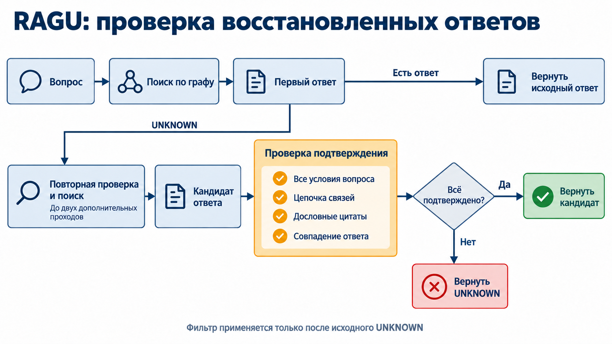

# Grounded answer recovery

Follow-up: [independently challenged fallback, new audit and implementation](monotone_recovery.md). The original results below are preserved.

After an initial `UNKNOWN`, RAGU reviews the context and can perform up to two additional retrieval passes. The new strict acceptance guard checks the recovered answer against every question constraint, intermediate relation, verbatim source quotation and answer agreement. Rejection restores the initial `UNKNOWN`, evidence and context. Initial substantive answers bypass this guard.

This is a post-retrieval and post-generation acceptance check, not weight regularization or model training. The selected configuration is `recovery_mode="after_review"`, `second_recovery_policy="deeper"`, `recovery_guard="chain"`. Additional modes remain off by default. See the [canonical API and prompt reference](../../ragu/search_engine/README.md#optional-acceptance-guard).

## Evaluation

We held retrieval, initial answers and recovery proposals fixed on MuSiQue. Accepted proposals are unchanged. Luna generated and verified answers; Sol evaluated correctness and source support separately. References never enter generation or verification.

Selection used 300 development questions. Frozen policies were applied to 2117 remaining questions, with a preselected new factual audit of 300 questions disjoint from development and the previous Sol audit. The benchmark had already been studied; this is not an untouched external test. Follow-up variants share the audit and are disclosed together.

| Metric | Initial | Unfiltered recovery | Strict guard |
|---|---:|---:|---:|
| ROUGE-L, no stemming, 2117 | 0.40787 | 0.52916 | **0.41697** |
| ROUGE-L, Porter, 2117 | 0.41082 | 0.53343 | **0.41992** |
| F1, 2117 | 0.41882 | 0.54275 | **0.42746** |
| EM, 2117 | 0.33916 | 0.42985 | **0.34577** |
| UNKNOWN, 2117 | 37.32% | 14.79% | **36.04%** |
| Correct among answers, audit 300 | 70.79% | 65.61% | **71.58%** |
| Unsupported among answers, audit 300 | 29.21% | 42.29% | **28.96%** |
| Correct and supported, audit 300 | 103 | 118 | **107** |

The strict guard retained **27 of 477** recovered answers. In the audit it added five correct answers, four supported and one unsupported. Thus the absolute unsupported count **increased from 52 to 53**, despite a slightly lower rate among answers. This does not eliminate hallucinations.

Paired question bootstrap, 10,000 resamples, seed 42: no-stem ROUGE-L delta +0.00910, 95% CI [0.00547, 0.01311]; answer precision +0.80pp, CI [0.16, 1.62]; unsupported rate −0.25pp, CI [−1.19,0.83]. The last interval includes zero. These intervals condition on fixed model outputs and Sol judgments.

## Rejected alternatives

Answer-blind reconstruction and the intersection of strict checks had no useful development gain. A lighter semantic checker also failed the fixed development constraints.

Replacing model-transcribed quotations with deterministic source IDs retained 13 newly correct-and-supported development answers versus three for the light checker. However, confirmation precision was 70.31% and unsupported rate 30.21%, worse than initial 70.79% and 29.21%. The variant was not admitted despite ROUGE-L 0.44470. Its source representation increased mean verifier input by about 33%, from 27,769 to 36,964 tokens.

Strict/light consensus passed its separate gate but retained fewer supported development answers, so it was not preferred by the frozen development rule. Confirmation was not used to reselect policies.

## Validation and limitations

Strict production replay covered all 2117 questions and three policies: 6351 trajectories, 1908 cached verifier calls, zero new inference calls. Messages, schemas, proofs, complete answers/evidence and contexts matched. Frozen upstream retrieval/recovery outputs were injected; recovery itself had a separate earlier replay.

Exact quotations verify text provenance, not semantic entailment. Context may contain generated graph descriptions. Initial substantive answers remain unverified. The small point-estimate gate does not establish statistical noninferiority or reduced unsupported incidence; useful recovery coverage is limited.

The main experiment fixes the existing BGE index. Reconstruction with `Alibaba-NLP/gte-multilingual-base` and transfer on the author's 498 questions are separate; this table is not an exact preprint reproduction.

Machine-readable results and provenance hashes: [grounded_recovery_summary.json](../assets/grounded_recovery_summary.json).

Hypothesis search used Arbor/Scientific Agent Skills procedures: [Kassis et al., 2026](https://doi.org/10.48550/arXiv.2609.00065).
