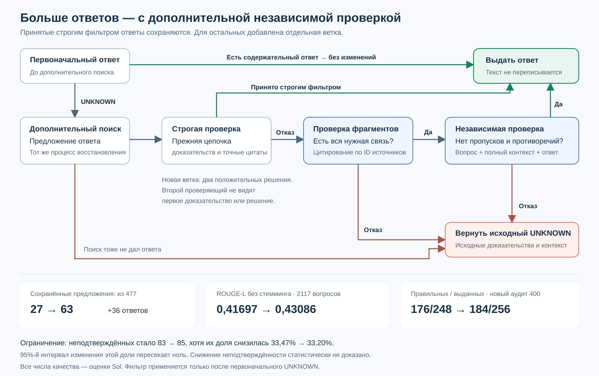

# Recovery acceptance with an independent fallback check

Follow-up experiment: [joint retrieval and context tuning across 18 recipes](factorial_screen.md). No new recipe passed selection; the implementation described here is retained.

The new opt-in guard passed the frozen evaluation gate. It preserves every answer accepted by the existing strict guard. When strict verification rejects a recovered answer, a source-span check and a separate full-context challenge must both accept it. The challenge receives the question, unchanged context and answer, without previous proof or verdict.



## Results

Retrieval, initial answers and recovery proposals were held fixed on MuSiQue. Luna performed method calls; Sol judged correctness and context support separately. The new random audit contains 400 questions disjoint from both earlier Sol audits. Selection used 300 development questions; the final composition was proposed after examining earlier development variants, then frozen before opening the new audit. The benchmark itself had already been studied, so this is not an untouched external test. The older span-only method had failed an earlier gate.

| Metric | Previous strict guard | New guard |
|---|---:|---:|
| Retained recoveries, all 2117 questions | 27 / 477 | **63 / 477** |
| ROUGE-L, no stemming, 2117 | 0.41697 | **0.43086** |
| ROUGE-L, Porter stemming, 2117 | 0.41992 | **0.43381** |
| Correct answers / answered, fresh 400 | 176 / 248 (70.97%) | **184 / 256 (71.88%)** |
| Correct and context-supported, fresh 400 | 140 | **146** |
| Wrong answers, fresh 400 | 72 | 72 |
| Unsupported answers, fresh 400 | 83 / 248 (33.47%) | **85 / 256 (33.20%)** |

The fallback retained 36 more proposals across 2117 questions. In the new audit it added eight answers: all eight were judged correct, six supported and two unsupported. The absolute unsupported count therefore increased despite its fraction decreasing. “Unsupported” is separate from “incorrect”; these are model judgments, not human-certified facts.

“Independent” means that the challenge cannot see the previous proof or verdict. Both calls use Luna, so their errors are not assumed statistically independent. These results use the earlier BGE-based index; the separate GTE reconstruction is not included and remains unfinished. They are not a matched-index reproduction of the preprint.

Paired bootstrap intervals (10,000 resamples, seed 42): ROUGE-L gain over strict +0.01389, 95% CI [0.00927, 0.01887]; precision gain +0.91 percentage points [0.33, 1.62]. Unsupported fraction change −0.26 points, CI [−1.23, +0.76], crossing zero. Passing the point-estimate gate does not establish a statistically reliable reduction in unsupported answers or prove noninferiority.

The filter still rejects 414 of 477 proposals. In the 400-question audit, its 82 rejected recovery proposals included 44 judged correct, of which 15 were also judged supported. There remains substantial avoidable abstention. Independent checking added 99 new calls for confirmation; including reused strict/span calls, the deployed route would execute 1026 guard calls for 477 recoveries.

Validation: 678 tests passed. All 2417 production trajectories and 1189 ordered cached guard calls replayed with zero new calls and no message, schema, answer, evidence, context or nested-audit mismatch. See the [compact validation receipt and source hashes](../assets/monotone_validation.json); it identifies the full local replay receipt and evaluation artifacts. The unchanged [earlier strict-guard report](grounded_recovery.md) uses a different audit cohort and should not be compared by mixing its factual rates with this table.

## Configuration and audit

```python
from ragu import EvidenceSearchParams

params = EvidenceSearchParams(
    recovery_mode="after_review",
    second_recovery_policy="deeper",
    recovery_guard="monotone",
)
# await engine.query(question, params)
```

The guard defaults to `off`. It only checks substantive answers recovered from an initial `UNKNOWN`. An initial substantive answer is preserved. Rejection restores the original answer, evidence and retrieval context. Acceptance preserves the recovered answer and evidence exactly. Streaming remains unsupported when recovery is enabled.

The guard makes one to three additional calls. `response.payload["answer_guard"]["checks"]["monotone"]` contains the strict decision, optional fallback decision, and all executed calls with actual messages and structured outputs. Source IDs and quotes establish provenance; semantic support remains a fallible model judgment. Preserving strict accepts does not guarantee unchanged precision among all returned answers.

Customize the three registered prompts with `engine.update_prompt`: `evidence_guard_monotone_strict`, `evidence_guard_monotone_span`, and `evidence_guard_monotone_challenge`. Preserve each registered output schema (`Proof`, `SpanProof`, `ChallengeProof` respectively). An incompatible schema raises `ValueError`. Text customization is recorded in every nested call audit, but changes the evaluated method; previously measured results then no longer apply directly. The same configured engine LLM serves all stages.

Offline replay: `experiments/replay_monotone_production.py --root PATH_TO_BENCHMARK --expected-commit COMMIT --output RECEIPT.json`. By default it requires completed discovery and confirmation artifacts, checks their hashes, and replays all ordered calls with no live provider. It exercises the production answer and guard path while injecting frozen initial and final-recovery states; it does not repeat retrieval or intermediate recovery inference.
